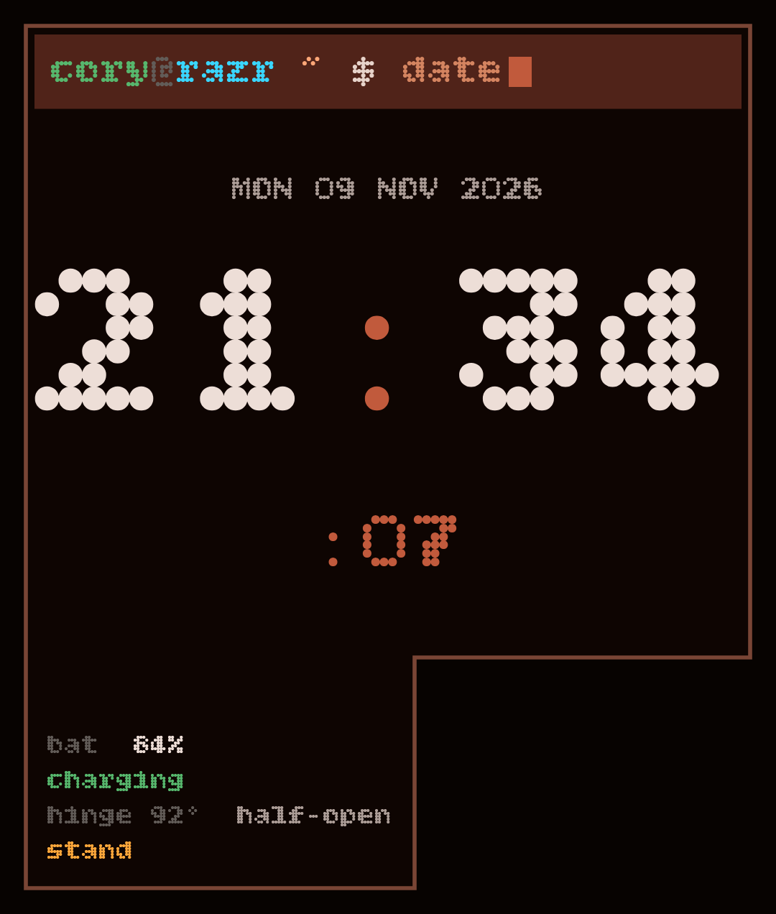

# razr-tui-clock

Terminal-style clock for the external cover of a Motorola Razr Ultra 2025 (codename leap, XT2551, Android 16). The face is a TUI: box frame, `cory@razr ~ $ date`, a blinking block cursor, and optional seconds, date, and battery. The default palette is Omarchy's Maine Autumn Sunset. The type is [Bitcount Grid Double](https://fonts.google.com/specimen/Bitcount+Grid+Double) (SIL OFL), bundled in the APK.



The frame stops at the cover's camera cutout, bounding rect `(585,923)-(1080,1272)`.

## Build

JDK 17+ and Android SDK platform 36.

```bash
./gradlew assembleDebug
```

Debug APK:

```text
app/build/outputs/apk/debug/razr-clock-debug.apk
```

`minSdk` is 34, `targetSdk` is 36, `compileSdk` is 36.

## Install

```bash
adb install -r app/build/outputs/apk/debug/razr-clock-debug.apk
adb shell am start -n com.coryblische.razrclock/.MainActivity
```

Open the app once on the inner display. That arms stand mode (a low-priority ongoing notification) and asks for notification permission. The settings screen is the inner-display UI. **Preview on this screen** shows the clock there.

## Cover screen: try this first

Display 1 is `1080x1272`, density 360, `FLAG_PRESENTATION | FLAG_OWN_CONTENT_ONLY | FLAG_OWN_DISPLAY_GROUP`, and `canHostTasks=false`. A normal `am start --display 1` or `ActivityOptions.setLaunchDisplayId(1)` is rejected while that flag stays false. Motorola's privileged cover launcher (`com.motorola.launcher.secondarydisplay`) is what actually places a third-party activity on that display, and only after you allow the app.

This app does **not** set Motorola's `cli_display_opt_out` meta-data. The launcher activity is resizeable and switches to the clock when it is on a non-default display or on a window with the cover's aspect (~0.85, 1080×1272).

1. Settings → **External display** → **App settings**.
2. **Razr Clock** → turn on **Allow on external display**.
3. Choose **Auto transition** so closing the phone keeps the clock on the cover. Manual transition makes you slide the icon. Don't transition leaves the app available only if you open it from the cover.
4. Optionally add Razr Clock to the cover **Apps** panel: close the phone, swipe to Apps, edit, and add it.
5. Open the app, then flip the phone closed. You should get the clock, not the settings list.

Expected failure if you skip the allow step:

```bash
adb shell am start --display 1 -n com.coryblische.razrclock/.MainActivity
```

That launch uses the same `setLaunchDisplayId` path the app tries only when `Display.canHostTasks()` is not false. On the dumpsys you captured, it should fail.

## What the app also tries

When stand mode is on and the phone is half-open (tent or stand), the app tries, in order:

1. **Jetpack WindowManager rear display.** If a `TYPE_REAR_FACING` area reports `PRESENT` as available, the resumed activity calls `presentContentOnWindowArea` and draws the clock into that session. **Move activity to rear display** calls `transferActivityToWindowArea` instead. That one can show a system confirmation. Many Motorola builds never publish this window area. The settings diagnostics line says so when it is missing.
2. **`android.app.Presentation` on the secondary `FLAG_PRESENTATION` display** (display 1), from the stand-mode foreground service. Android 16 allows presentations on internal displays that carry that flag. The system still throws `InvalidDisplayException` if the presentation would cover this app's own task, or if the process is not allowed to add a window there. Failures are caught and written to the diagnostics line. **Show on cover display now** runs this immediately so you can see the error without folding the phone.
3. **`ActivityOptions.setLaunchDisplayId`**, only when reflected `canHostTasks()` is not `false`. A `false` result is not attempted.
4. **A full-screen-intent notification** that brings `MainActivity` forward on whichever display the system will actually host a task on. On Android 14+ that special access is not granted to a normal app until you allow it. Settings has a button, or:

   ```bash
   adb shell appops set com.coryblische.razrclock USE_FULL_SCREEN_INTENT allow
   ```

5. **A `DreamService`** (`com.coryblische.razrclock.RazrClockDream`). This is the charging / idle screensaver, independent of the cover display accepting tasks:

   ```bash
   adb shell cmd dream set-dream com.coryblische.razrclock/.RazrClockDream
   adb shell cmd dream enable
   adb shell cmd dream start
   ```

   Or use **Screensaver settings** in the app.

Motorola's own **Desk display** (Settings → External display → Desk display, and `com.motorola.systemui.desk`) already owns tent and stand on the cover. Turn **Show info in tent mode** and **Show info in stand mode** off if you want this clock to be the thing on the cover. Otherwise the system desk clock can cover a third-party presentation.

## Stand mode

Half-open is hinge angle from 20° through 160° on `android.sensor.hinge_angle` (type 36, the wakeup sensor when the device has one). The angle wins over everything else. `com.motorola.sensor.hinge_posture` (type 65583) is only a fallback when the angle sensor is missing. Its enum is not public. This app treats raw `1` as closed, `2` and `5` as half-open, and `3` as open, and ignores other codes. `FoldingFeature.State.HALF_OPENED` is used only when the angle is unknown.

While that posture holds, and stand mode is enabled:

- The clock is shown.
- The screen stays on (`FLAG_KEEP_SCREEN_ON`).
- Brightness is forced to 12% (`screenBrightness = 0.12`).
- **Only while charging** (off by default) also requires `CHARGING` or `FULL`.

Leave the posture and the timeout and brightness go back to normal. The foreground service stays armed until you turn stand mode off. After reboot it tries to re-arm. Android 16 may block that `specialUse` start from `BOOT_COMPLETED`. Open the app once if the notification is missing.

Logs:

```bash
adb logcat -s RazrClock
```

## Theme

Default colors are `app/src/main/assets/colors.toml` (Maine Autumn Sunset, dark). Any missing key falls back to the same hardcoded palette. To swap without rebuilding, launch the app once, then:

```bash
adb push colors.toml /sdcard/Android/data/com.coryblische.razrclock/files/colors.toml
adb shell am force-stop com.coryblische.razrclock
adb shell am start -n com.coryblische.razrclock/.MainActivity
```

Keys: `accent`, `selection`, `selection_foreground`, `muted`, `background`, `dark_background`, `darker_background`, `lighter_background`, `foreground`, `dark_foreground`, `light_foreground`, `bright_foreground`, `red`, `yellow`, `orange`, `green`, `cyan`, `blue`, `magenta`, `brown`, `bright_red`, `bright_yellow`, `bright_green`, `bright_cyan`, `bright_blue`, `bright_magenta`.

## Font

`app/src/main/res/font/bitcount_grid_double.ttf` is the variable **Bitcount Grid Double** file (`wght`, `ELXP`, `ELSH`, `slnt`, `CRSV`). The license is `app/src/main/assets/fonts/OFL.txt`. The instance used here is weight 400–500, `ELXP` 8, `ELSH` 0, `slnt` 0, `CRSV` 0: square pixels, upright, not cursive, only slightly expanded, so the double stroke stays readable at cover size on OLED instead of filling in. Bitcount has no box-drawing block, so the frame and the cursor are drawn, not typed.

## What is uncertain on the real phone

This was not run on an XT2551. The snapshot is a Compose render at 1080×1272 px and 360 dpi, not a photo of the cover.

- The allow-on-external-display path is the one Motorola documents. `canHostTasks=false` means the other launches are best-effort.
- `FLAG_OWN_CONTENT_ONLY` may mean a third-party `Presentation` is rejected even though `FLAG_PRESENTATION` is set. **Show on cover display now** prints the exception if so.
- Leap may not implement Jetpack `TYPE_REAR_FACING`. The diagnostics line is the check.
- The vendor posture codes above can be wrong. They never override a live hinge angle, and this phone has that sensor.
- Desk display can sit on top of anything we present while the phone is tented. Turning that feature off is part of setup, not something an ordinary app can do for you.
- Full-screen intents and background activity starts are restricted. Without the special access grant, stand mode can still show a presentation and the ongoing notification, but it may not be able to pull the activity up by itself.
